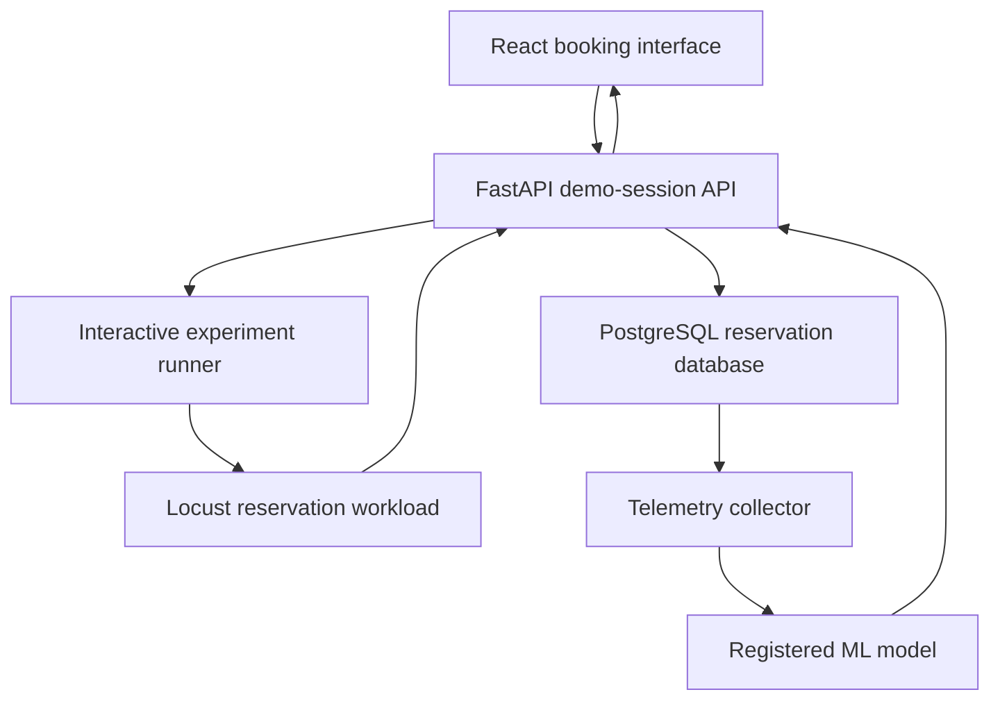

# Lock Contention Prediction for PostgreSQL Reservation Workloads

A final-year academic project that simulates concurrent cinema-ticket
reservations, captures PostgreSQL and application telemetry, and predicts
near-future lock-contention risk with a registered machine-learning model.

The repository includes a FastAPI backend, PostgreSQL persistence, Locust
workload generation, telemetry collection, model training and inference,
a React booking interface, and a controlled browser-driven demonstration.

## Project status

The planned implementation and interactive demonstration are complete.

Verified results:

| Check | Result |
|---|---:|
| Python tests | 303 passed |
| Frontend production build | Passed |
| Frontend lint | 0 warnings, 0 errors |
| Alembic schema check | No pending operations |
| Baseline demonstration | LOW risk |
| Contention demonstration | Reached HIGH risk |
| Browser-selected seats | 1–5 consecutive seats |
| Multi-seat booking | Atomic |
| Multi-seat reset | Atomic and tested |

The remaining project work is documentation, evidence packaging, academic
report writing, and presentation preparation.

## Interactive demonstration

The main presentation workflow is:

1. Start the FastAPI backend.
2. Start the React frontend.
3. Run the interactive-demo command.
4. The runner randomly selects a baseline or contention scenario.
5. Select one to five consecutive available seats in one row.
6. The runner creates an experiment using those exact seats.
7. Locust generates reservation traffic while PostgreSQL telemetry is sampled.
8. The active model produces live contention-risk predictions.
9. Confirm all selected seats together in the browser.
10. The runner stops after the selected seats are confirmed.
11. Reset the demonstration seats before another run.

Automatic mode randomly chooses a workload scenario. It does not directly set
or falsify the model prediction. The model independently evaluates collected
telemetry.

Detailed instructions are available in
[`docs/demo/interactive_browser_demo.md`](docs/demo/interactive_browser_demo.md).

## Verified demonstration behavior

The final automatic acceptance run selected the contention scenario and used
five browser-selected seats.

| Sample | Probability | Classification |
|---:|---:|---|
| 1 | 0.320377 | LOW |
| 2 | 0.437017 | HIGH |
| 3 | 0.634886 | HIGH |

The first sample was collected during workload ramp-up. A contention scenario
can initially produce LOW risk before sufficient pressure is visible in the
telemetry. This is expected and is more scientifically honest than forcing all
samples to report HIGH.

A separate baseline acceptance run produced three LOW predictions with an
average probability of `0.019840`.

## System architecture



The live workflow preserves an evidence chain from real requests to persisted
telemetry and model predictions:

```text
booking traffic
→ PostgreSQL transactions and row locks
→ metric samples
→ active-model inference
→ persisted predictions
→ browser-visible risk
```

## Main capabilities

- PostgreSQL reservation schema with explicit constraints and indexes.
- Transactional seat booking with row-level locking.
- Idempotent booking requests.
- Atomic multi-seat demonstration booking.
- Experiment lifecycle management.
- Configurable Locust demand and traffic patterns.
- PostgreSQL and application telemetry collection.
- Training-dataset construction and validation.
- Model training, evaluation, registration, and activation.
- Automatic prediction for every complete metric sample.
- Prediction provenance and future-label separation.
- Browser-driven interactive baseline/contention demonstration.
- Safe dry-run and apply modes for resetting demonstration seats.
- Separate development and test databases.

## Technology stack

| Layer | Technology |
|---|---|
| Backend API | Python, FastAPI |
| Persistence | PostgreSQL, SQLAlchemy |
| Migrations | Alembic |
| Workload generation | Locust |
| Monitoring | PostgreSQL statistics and application metrics |
| Machine learning | pandas, NumPy, scikit-learn, joblib |
| Frontend | React, TypeScript, Vite |
| Testing | pytest |
| Frontend validation | TypeScript build and oxlint |

## Repository layout

```text
backend/
  app/
    api/             FastAPI routes
    core/            application configuration
    db/              database engine and sessions
    models/          SQLAlchemy models
    repositories/    persistence queries
    schemas/         request and response contracts
    services/        transaction and domain logic

database/
  migrations/        Alembic migration environment
  seed.py            deterministic demonstration seed data

data_pipeline/       dataset creation, export, calibration, and audit
load_testing/        Locust workloads and experiment runners
model_training/      training, selection, evaluation, and registration
monitoring/          telemetry, inference, labeling, and coverage checks
frontend/            React and TypeScript booking interface
tests/               API, integration, ML, monitoring, and workload tests
docs/                contracts, evidence, decisions, and runbooks
```

## Prerequisites

The verified local environment uses:

- macOS on Apple Silicon;
- Python 3.11;
- PostgreSQL 16;
- Node.js and npm;
- Git.

Equivalent supported versions may work, but they have not all been validated.

## Initial setup

### 1. Clone and enter the repository

```bash
git clone https://github.com/miyabrijesh/lock-contention-prediction.git
cd lock-contention-prediction
```

### 2. Create the Python environment

```bash
python3 -m venv .venv
source .venv/bin/activate

python -m pip install --upgrade pip
python -m pip install -r requirements-lock.txt
```

### 3. Create the databases

```bash
createdb lock_contention_db
createdb lock_contention_test_db
```

The application uses `lock_contention_db`. Automated tests use
`lock_contention_test_db`.

### 4. Configure local environment values

```bash
cp .env.example .env
```

Edit `.env` and replace:

```text
YOUR_MAC_USERNAME
replace_with_private_token
```

For local experiment execution, set:

```text
EXPERIMENT_MODE_ENABLED=true
```

Never commit `.env` or real token values.

### 5. Apply development migrations

```bash
alembic upgrade head
```

### 6. Apply test-database migrations

Replace `<username>` with the local PostgreSQL role:

```bash
DATABASE_URL="postgresql+psycopg://<username>@localhost:5432/lock_contention_test_db"   alembic upgrade head
```

### 7. Seed development data

```bash
python -m database.seed
```

The seed provides:

- 200 synthetic users;
- one normal booking show;
- one experiment show;
- 100 seats per show.

### 8. Install frontend dependencies

```bash
cd frontend
npm ci
cd ..
```

## Running the application

Use three terminal tabs.

### Terminal 1 — FastAPI backend

```bash
cd ~/Documents/lock-contention-prediction
source .venv/bin/activate
export EXPERIMENT_MODE_ENABLED=true

python -m uvicorn   backend.app.main:app   --reload   --host 127.0.0.1   --port 8001
```

Backend URLs:

- API: `http://127.0.0.1:8001`
- OpenAPI: `http://127.0.0.1:8001/docs`
- readiness: `http://127.0.0.1:8001/health/ready`

### Terminal 2 — React frontend

```bash
cd ~/Documents/lock-contention-prediction/frontend
npm run dev
```

Open:

```text
http://localhost:5173
```

The frontend defaults to `http://127.0.0.1:8001` for the API. A different API
address can be supplied with `VITE_API_BASE_URL`.

### Terminal 3 — interactive runner

```bash
cd ~/Documents/lock-contention-prediction
source .venv/bin/activate

python -m load_testing.run_interactive_demo   --duration 60   --selection-timeout 300
```

Do not supply `--scenario` when demonstrating random selection.

For deterministic rehearsal:

```bash
python -m load_testing.run_interactive_demo   --scenario baseline   --duration 60   --selection-timeout 300
```

or:

```bash
python -m load_testing.run_interactive_demo   --scenario contention   --duration 60   --selection-timeout 300
```

## Resetting demonstration seats

Always perform a dry run first:

```bash
python -m load_testing.reset_interactive_demo   --seat-number B4   --seat-number B5   --seat-number B6
```

Apply the reset only after checking the plan:

```bash
python -m load_testing.reset_interactive_demo   --seat-number B4   --seat-number B5   --seat-number B6   --apply
```

All requested seats are processed in one database transaction. If any seat is
invalid or an experiment is running, the batch is rejected.

## Verification

Run the complete Python suite:

```bash
pytest -q
```

Check migration consistency:

```bash
alembic check
```

Verify Python entry points:

```bash
python -m py_compile   load_testing/run_interactive_demo.py   load_testing/reset_interactive_demo.py
```

Build and lint the frontend:

```bash
cd frontend
npm run build
npm run lint
cd ..
```

Check whitespace and repository state:

```bash
git diff --check
git status --short
```

## Important API groups

| Area | Prefix or endpoint |
|---|---|
| Health | `/health` |
| Shows and seats | `/api/v1/shows` |
| Bookings | `/api/v1/bookings` |
| Experiments | `/api/v1/experiments` |
| Predictions | `/api/v1/predictions` |
| Interactive demo | `/api/v1/demo` |
| OpenAPI documentation | `/docs` |

The generated OpenAPI page is the authoritative runtime view of request and
response schemas.

## Prediction interpretation

The configured prediction horizon is 30 seconds. Each complete telemetry
sample is evaluated by the active registered model and retains:

- prediction probability;
- risk level;
- threshold;
- model-version provenance;
- target time window;
- staleness state;
- quality flags;
- later-assigned actual-label evidence.

The workload scenario and model output must not be described as the same
thing. A contention workload is intended to create pressure, but the observed
telemetry determines the prediction.

## Safety boundaries

- Use the development database for demonstrations.
- Use the test database for pytest.
- Do not run the reset utility during a running experiment.
- Run reset without `--apply` before changing data.
- Do not expose API tokens in logs, screenshots, or documentation.
- Do not claim that a probability proves contention with certainty.
- Do not claim production scalability from local controlled experiments.

## Limitations

This is a controlled academic prototype, not a production ticketing platform.

Current limitations include:

- local single-machine validation;
- synthetic reservation users;
- controlled workload scenarios;
- no production authentication or payment integration;
- no claim of universal model generalization;
- predictions depend on the active model and available telemetry;
- the live-status page may show no recent prediction after an experiment
  completes because it represents current live state.

## Documentation

Important references include:

- [`docs/demo/interactive_browser_demo.md`](docs/demo/interactive_browser_demo.md)
- [`docs/demo/phase7_end_to_end_demo.md`](docs/demo/phase7_end_to_end_demo.md)
- [`docs/data/dataset_contract.md`](docs/data/dataset_contract.md)
- [`docs/data/training_split_contract.md`](docs/data/training_split_contract.md)
- [`docs/model_training/inference_contract_v1.md`](docs/model_training/inference_contract_v1.md)
- [`docs/model_training/model_activation_contract_v1.md`](docs/model_training/model_activation_contract_v1.md)
- [`docs/model_validation/live_label_contract_v2.md`](docs/model_validation/live_label_contract_v2.md)
- [`docs/model_validation/phase_8a_model_decision.md`](docs/model_validation/phase_8a_model_decision.md)

## Academic scope

The project demonstrates that lock-contention prediction can be integrated
into a transactional reservation workflow with reproducible workload
generation, persisted telemetry, controlled model activation, prediction
provenance, and a browser-visible live demonstration.

It does not claim that one model or one local experiment generalizes to every
production PostgreSQL workload.
