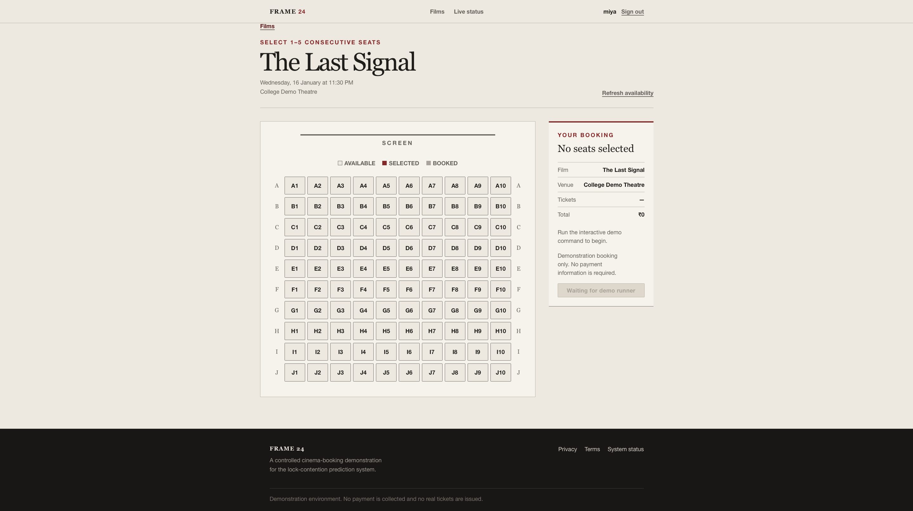
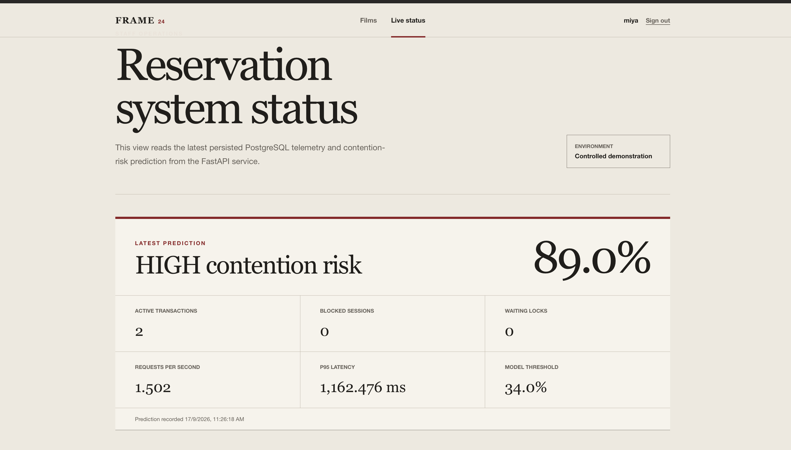
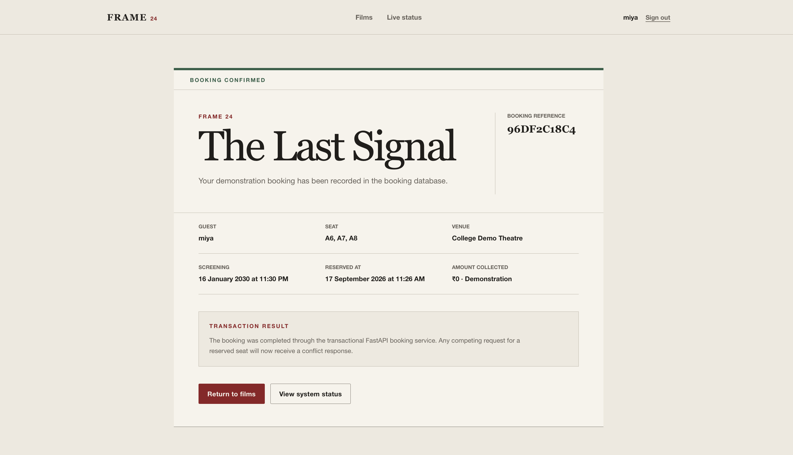
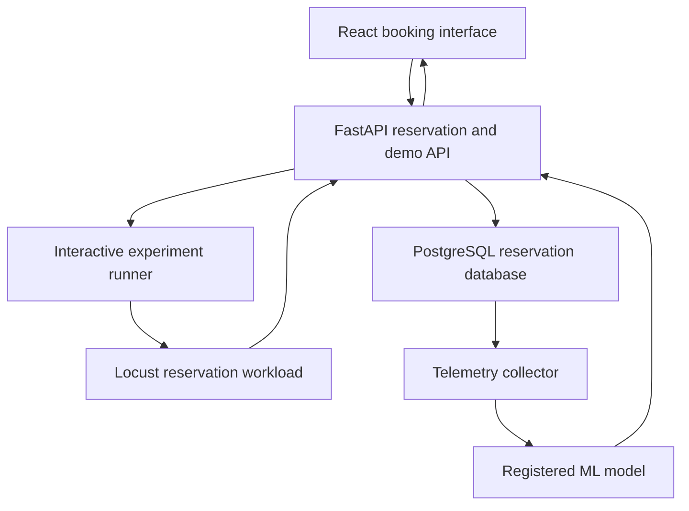

# Short-Horizon Prediction of PostgreSQL Lock Contention in Reservation Systems

A final-year academic project that simulates concurrent cinema-ticket reservations, captures PostgreSQL and application telemetry, and predicts whether a defined high-contention condition will occur in the next 30 seconds.

The repository contains a FastAPI backend, PostgreSQL persistence, Locust workload generation, telemetry collection, dataset construction, model training and evaluation, registered-model inference, a React booking interface, and a browser-driven demonstration.

The revised manuscript, **“Short-Horizon Prediction of PostgreSQL Lock Contention in Reservation Systems”** (IConSCEPT 2026, Paper 526), has been submitted. The results below are from controlled experiments; they do not establish production performance.

## Contents

- [Project status](#project-status)
- [Research question and experimental design](#research-question-and-experimental-design)
- [Research results](#research-results)
- [Reproduce the frozen test result](#reproduce-the-frozen-test-result)
- [Interactive demonstration](#interactive-demonstration)
- [Frontend interface](#frontend-interface)
- [Recorded demonstration behavior](#recorded-demonstration-behavior)
- [System architecture](#system-architecture)
- [Main capabilities](#main-capabilities)
- [Technology stack](#technology-stack)
- [Repository layout](#repository-layout)
- [Prerequisites](#prerequisites)
- [Initial setup](#initial-setup)
- [Running the application](#running-the-application)
- [Resetting demonstration seats](#resetting-demonstration-seats)
- [Verification](#verification)
- [Important API groups](#important-api-groups)
- [Prediction interpretation](#prediction-interpretation)
- [Safety boundaries](#safety-boundaries)
- [Limitations](#limitations)
- [Documentation](#documentation)
- [Academic scope](#academic-scope)

## Project status

The application, experimental pipeline, and interactive demonstration are implemented. The main paper result has also been reproduced from a fresh clone using the original Python environment and separately supplied frozen split CSVs.

The following checks were recorded during project acceptance. They are historical verification results, not a live CI status badge.

| Check | Recorded result |
| --- | --- |
| Python test suite | 303 passed |
| Frontend production build | Passed |
| Frontend lint | 0 warnings, 0 errors |
| Alembic schema check | No pending operations |
| Baseline demonstration | LOW risk |
| Contention demonstration | Reached HIGH risk |
| Browser-selected seats | 1–5 consecutive seats in one row |
| Multi-seat booking | Atomic |
| Multi-seat reset | Atomic and tested |

## Research question and experimental design

### Prediction target

Given database and application telemetry available at time `t`, predict whether the defined high-contention condition will be observed during the following 30 seconds. The outcome window is `(t, t + 30 seconds]`: the observation at `t` is not part of its own future outcome.

The model uses **18 prediction-time features** covering transactions, locks, connections, workload activity, request latency, and booking outcomes. Future-window metrics, persisted model probabilities, risk levels, and decision thresholds are excluded from the input features. Deadlock increments used as prediction-time features are distinct from deadlock evidence used to label future outcomes.

The label is an operational definition used for this study, not a universal PostgreSQL definition of high contention. See the [dataset contract](docs/data/dataset_contract.md) and the [verified future-window label contract](docs/model_validation/live_label_contract_v2.md) for the corresponding project definitions.

### Controlled workload

Locust generates concurrent HTTP booking requests against the reservation API. The original systematic campaign varied traffic shape, demand concentration, configured user count, and random seed. The original dataset contains **2,666 labelled telemetry rows from 60 experiments**, sampled at two-second intervals.

The split was performed by **experiment**, not by individual telemetry row. This keeps rows from the same run from appearing in both model development and held-out evaluation.

| Split | Experiments | Role |
| --- | ---: | --- |
| Training | 42 | Fit candidate models |
| Validation | 9 | Select the model and operating threshold |
| Frozen test | 9 | Evaluate the selected model without further tuning |

### Models and selection

The study considered a prevalence baseline, logistic regression, and random forest. The revision also evaluated a reactive monitoring rule that raises an alert when `waiting_locks >= 1`.

Logistic regression was selected using **validation average precision**. Its classification threshold of **0.34** was selected using validation F₂, which gives recall more weight than precision. The frozen test split was not used for either decision.

## Research results

### Frozen held-out test

The selected logistic regression model and reactive rule were evaluated against the same future-window labels on **402 rows from nine held-out experiments**.

| Method | Accuracy | Precision | Recall | F₂ | TN | FP | FN | TP |
| --- | ---: | ---: | ---: | ---: | ---: | ---: | ---: | ---: |
| Reactive rule: `waiting_locks >= 1` | 85.82% | 90.05% | 85.04% | 86.00% | 146 | 22 | 35 | 199 |
| Logistic regression: threshold `0.34` | 85.32% | 81.14% | 97.44% | 93.67% | 115 | 53 | 6 | 228 |

The selected model achieved **98.22% average precision** and **97.08% ROC-AUC**. The report stores average precision under the key `pr_auc`.

Compared with the reactive rule, the model identified **29 more positive test windows** and generated **31 more false-positive windows**. The predictive model therefore improved recall at the cost of precision and alert volume. These are counts of labelled prediction windows, not counts of distinct contention incidents.

### Uncertainty under temporal dependence

Telemetry was sampled every two seconds, but each target window spans 30 seconds. Adjacent observations from the same run can share future evidence, so treating them as independent rows can understate uncertainty.

The revised evaluation resampled **whole test experiments**, preserving within-run dependence. The original row-level intervals are retained below for comparison.

| Metric | Point estimate | Row-level 95% interval | Experiment-clustered 95% interval |
| --- | ---: | ---: | ---: |
| Accuracy | 85.32% | 82.09–88.56% | 68.67–98.02% |
| Recall | 97.44% | 95.30–99.15% | 91.21–100.00% |
| Precision | 81.14% | 77.78–84.67% | 55.07–97.75% |
| Average precision | 98.22% | 97.37–98.98% | 88.59–100.00% |

The experiment-clustered intervals are wider. With only nine held-out experiments, they should be interpreted as uncertainty estimates for this controlled evaluation, not as guarantees for new deployments.

### Repeated experiment-grouped model comparison

A separate analysis compared logistic regression and random forest across repeated experiment-grouped folds on the **2,264 development rows from 51 experiments**. The frozen test split was excluded.

| Model | Mean average precision | Fold range |
| --- | ---: | ---: |
| Logistic regression | 94.06% | 91.29–97.41% |
| Random forest | 93.33% | 90.90–96.56% |

Logistic regression had the higher mean in this comparison. The gap was small, and the fold ranges overlapped. This is development-set evidence, not proof that logistic regression will outperform random forest on every workload.

### Feature ablation

The ablation analysis ranked features within the development folds and evaluated smaller feature sets without using the frozen test split.

| Feature set | Mean average precision |
| --- | ---: |
| Top 3 | 92.36% |
| Top 6 | 93.79% |
| Top 9 | 94.01% |
| Top 12 | 94.06% |
| All 18 | 94.06% |

The 12-feature and full-feature configurations had the same mean to the reported precision. This motivates testing smaller input sets but does not establish that the models are equivalent. Validation permutation importance and grouped ablation are separate analyses; neither directly quantifies feature interactions.

### Workload-shift evaluation

The active model was evaluated on a separate **15-experiment campaign** with **662 verified labelled rows**. The campaign introduced an intermediate workload configuration with 30 configured users and 150 ms of simulated transaction work.

| Outcome | Count |
| --- | ---: |
| True negatives | 7 |
| False positives | 110 |
| False negatives | 1 |
| True positives | 544 |

The model detected **544 of 545 positive windows** (**99.82% recall**) but correctly classified only **7 of 117 negative windows** (**5.98% specificity**). The negative rows had a mean model score of `0.6736`, above the `0.34` alert threshold. Configured users was the largest measured standardized feature shift; this observation does not establish that it caused the false positives.

Possible mitigations include threshold recalibration on new labelled runs, requiring repeated elevated scores before alerting, and applying alert cooldowns. These strategies were not validated as part of the frozen-test result. The frozen test set should not be used to tune them.

The [workload-shift model decision](docs/model_validation/phase_8a_model_decision.md) documents a separate candidate evaluation and why that candidate was not promoted.

### Local inference latency

A local model-scoring benchmark recorded:

| Statistic | Time |
| --- | ---: |
| Median (p50) | 0.2212 ms |
| p95 | 0.2283 ms |
| p99 | 0.2456 ms |
| Mean | 0.2225 ms |

These times cover model scoring only. They exclude database queries, telemetry collection, HTTP handling, and network time. They are not end-to-end alert latency measurements.

## Reproduce the frozen test result

The main result was reproduced from a fresh clone at commit:

```text
d58655a6d2da4e2d90a7a1143706fa84ea2724bc
```

The successful run used the original project's Python environment and separately supplied frozen v1 split files. It scored the saved model without retraining, choosing a new threshold, or overwriting the tracked evaluation report.

### Required inputs

| Input | Location or requirement |
| --- | --- |
| Evaluator | `model_training/evaluate_candidate.py` |
| Frozen model | `artifacts/models/contention_candidate_v1.joblib` |
| Selection report | `docs/model_training/candidate_selection_v1.json` |
| Frozen split manifest | `docs/data/contention_training_dataset_v1_splits.json` |
| Frozen split CSVs | Supply `train.csv`, `validation.csv`, and `test.csv` together in one directory |
| Python environment | Activate an environment with the project's Python dependencies installed |

The evaluator, model, selection report, and manifest were available in the clone. **The frozen CSVs were not. A clone alone is not enough to reproduce the result.** All three CSVs are required by the evaluator, even though the reported metrics are computed only on the test split.

Only load a trusted model artifact. The offline check does not require PostgreSQL, the frontend, or a Locust process.

### Run the evaluator

Run from the repository root with the Python environment active. The first line below is the path used in the successful local check. Change it if the frozen CSVs are stored elsewhere.

```bash
split_dir="$HOME/Documents/lock-contention-prediction/data/processed/splits/contention_training_dataset_v1"
repro_dir="$(mktemp -d)" &&
python -m model_training.evaluate_candidate \
  --model-file artifacts/models/contention_candidate_v1.joblib \
  --selection-report docs/model_training/candidate_selection_v1.json \
  --split-directory "$split_dir" \
  --manifest-file docs/data/contention_training_dataset_v1_splits.json \
  --output-file "$repro_dir/frozen-test-reproduced.json" &&
python -m json.tool "$repro_dir/frozen-test-reproduced.json"
```

A new temporary output path keeps the original evaluation report intact. The message `Further automatic test evaluation: blocked` is part of the evaluator's successful completion output; it does not mean the run failed.

### Expected output

| Check | Expected value |
| --- | --- |
| Model | `logistic_regression` |
| Classification threshold | `0.34` |
| Test rows | `402` |
| Held-out experiments | `9` |
| Positive / negative labels | `234 / 168` |
| Confusion matrix | `TN=115, FP=53, FN=6, TP=228` |
| Accuracy | `0.8532` |
| Precision | `0.8114` |
| Recall | `0.9744` |
| Average precision (`pr_auc`) | `0.9822` |
| ROC-AUC | `0.9708` |
| F₂ | `0.9367` |

The reproduced report recorded the following SHA-256 for `test.csv`:

```text
71b4cf3befcd0661aa2954aef2e7d431c08653f676e9998ca9bfa6cb81e7f0b8
```

The original result is recorded in the [frozen evaluation report](docs/model_training/final_test_evaluation_v1.json). Matching it reproduces the paper's main frozen-test result. It does not independently reproduce every follow-up analysis or validate the model on a new workload.

## Interactive demonstration

The demonstration connects a browser booking session to a controlled reservation workload and displays the model's live output.

1. Start the FastAPI backend.
2. Start the React frontend.
3. Start the interactive experiment runner.
4. In automatic mode, the runner randomly selects a baseline or contention scenario.
5. Select one to five consecutive available seats in one row in the browser.
6. The runner creates an experiment using those exact seats.
7. Locust generates reservation traffic while telemetry is collected.
8. The active model scores complete telemetry samples and persists predictions.
9. Confirm all selected seats together in the browser.
10. The runner stops after the selected seats are confirmed.
11. Reset the demonstration seats before reusing them.

Automatic scenario selection does not directly set the predicted risk. The scenario controls the workload; the model evaluates the resulting telemetry.

See the [interactive browser demo runbook](docs/demo/interactive_browser_demo.md) for the full walkthrough.

## Frontend interface

### Seat selection

The React interface provides a cinema-style seat map for selecting the seats used in the interactive experiment.



### Live contention prediction

The system-status view displays the latest persisted risk prediction together with telemetry used to interpret the current workload.



### Atomic booking confirmation

The selected seats are confirmed together through the transactional batch booking service.



## Recorded demonstration behavior

The recorded automatic acceptance run selected the contention scenario and used five browser-selected seats.

| Sample | Model score | Classification |
| ---: | ---: | --- |
| 1 | 0.320377 | LOW |
| 2 | 0.437017 | HIGH |
| 3 | 0.634886 | HIGH |

The first sample was collected during workload ramp-up. A contention scenario can initially produce LOW risk before sufficient pressure appears in the telemetry. The runner does not force a HIGH result.

A separate baseline acceptance run produced three LOW predictions with a mean score of `0.019840`. These are examples from specific demo runs, not benchmark averages or guaranteed outputs.

## System architecture



The live evidence chain begins with HTTP booking requests. Those requests exercise PostgreSQL transactions and row locks, which are observed through database and application telemetry. The active model scores complete samples, and the resulting predictions are persisted for display in the browser. Later-assigned outcome labels are kept separate from the prediction-time inputs.

## Main capabilities

- PostgreSQL reservation schema with explicit constraints and indexes.
- Transactional seat booking with row-level locking.
- Idempotent booking requests.
- Atomic multi-seat demonstration booking.
- Experiment lifecycle management.
- Configurable Locust demand profiles and traffic patterns.
- PostgreSQL and application telemetry collection.
- Training-dataset construction, validation, and experiment-grouped splitting.
- Model training, selection, evaluation, registration, and activation.
- Automatic inference for complete telemetry samples.
- Prediction provenance and future-label separation.
- Browser-driven baseline and contention demonstrations.
- Preview and apply modes for resetting demonstration seats.
- Separate development and test databases.
- Offline scoring of the frozen paper model with separately supplied evaluation data.

## Technology stack

| Layer | Technology |
| --- | --- |
| Backend API | Python, FastAPI |
| Persistence | PostgreSQL, SQLAlchemy |
| Migrations | Alembic |
| Workload generation | Locust |
| Monitoring | PostgreSQL statistics and application metrics |
| Machine learning | pandas, NumPy, scikit-learn, joblib |
| Frontend | React, TypeScript, Vite |
| Python testing | pytest |
| Frontend verification | TypeScript build, oxlint |

## Repository layout

```text
backend/
  app/
    api/             FastAPI routes
    core/            Application configuration
    db/              Database engine and sessions
    models/          SQLAlchemy models
    repositories/    Persistence queries
    schemas/         Request and response contracts
    services/        Transaction and domain logic

database/
  migrations/        Alembic migration environment
  seed.py            Deterministic demonstration seed data

artifacts/
  models/            Saved model artifacts

data_pipeline/       Dataset creation, export, calibration, and audit
load_testing/        Locust workloads and experiment runners
model_training/      Training, selection, evaluation, and registration
monitoring/          Telemetry, inference, labelling, and coverage checks
frontend/            React and TypeScript booking interface
tests/               API, integration, ML, monitoring, and workload tests
docs/                Contracts, evidence, decisions, and runbooks
analysis_outputs/    Generated analysis reports
```

## Prerequisites

The verified local application environment uses:

- macOS on Apple Silicon;
- Python 3.11;
- PostgreSQL 16;
- Node.js and npm;
- Git.

Other environments may work but have not all been validated. The steps below are for the full application and demo. If you only want to reproduce the frozen test metrics, see [Reproduce the frozen test result](#reproduce-the-frozen-test-result).

## Initial setup

### 1. Clone and enter the repository

```bash
git clone https://github.com/miyabrijesh/lock-contention-prediction.git
cd lock-contention-prediction
```

### 2. Create the Python environment

```bash
python3.11 -m venv .venv
source .venv/bin/activate

python -m pip install --upgrade pip
python -m pip install -r requirements-lock.txt
```

### 3. Create the databases

With PostgreSQL running locally:

```bash
createdb lock_contention_db
createdb lock_contention_test_db
```

The application and demonstration use `lock_contention_db`. Automated tests use `lock_contention_test_db`. Keep these databases separate.

### 4. Configure local environment values

In a fresh checkout:

```bash
cp .env.example .env
```

Edit `.env`:

- Replace `YOUR_MAC_USERNAME` with your local PostgreSQL role.
- Replace `replace_with_private_token` with a private local token.
- Set `EXPERIMENT_MODE_ENABLED=true` for local experiment execution.

Never commit `.env` or real token values.

### 5. Apply development migrations

Ensure the application configuration points to the development database, then run:

```bash
alembic upgrade head
```

### 6. Apply test-database migrations

Replace `YOUR_POSTGRES_ROLE` with your local PostgreSQL role before running:

```bash
DATABASE_URL="postgresql+psycopg://YOUR_POSTGRES_ROLE@localhost:5432/lock_contention_test_db" \
  alembic upgrade head
```

### 7. Seed development data

With the application pointing at the development database:

```bash
python -m database.seed
```

The seed provides:

- 200 synthetic users;
- one normal booking show;
- one experiment show;
- 100 seats per show.

### 8. Install frontend dependencies

From the repository root:

```bash
cd frontend
npm ci
cd ..
```

## Running the application

Use three terminal tabs. Start each tab at the repository root.

### Terminal 1 — FastAPI backend

```bash
source .venv/bin/activate
export EXPERIMENT_MODE_ENABLED=true

python -m uvicorn backend.app.main:app \
  --reload \
  --host 127.0.0.1 \
  --port 8001
```

Backend URLs:

- API: `http://127.0.0.1:8001`
- OpenAPI: `http://127.0.0.1:8001/docs`
- Readiness: `http://127.0.0.1:8001/health/ready`

### Terminal 2 — React frontend

```bash
cd frontend
npm run dev
```

Open `http://localhost:5173`. The frontend defaults to `http://127.0.0.1:8001` for the API. Set `VITE_API_BASE_URL` if you need to use a different API address.

### Terminal 3 — Interactive runner

```bash
source .venv/bin/activate

python -m load_testing.run_interactive_demo \
  --duration 60 \
  --selection-timeout 300
```

Leave out `--scenario` to use random scenario selection.

For a baseline rehearsal:

```bash
python -m load_testing.run_interactive_demo \
  --scenario baseline \
  --duration 60 \
  --selection-timeout 300
```

For a contention rehearsal:

```bash
python -m load_testing.run_interactive_demo \
  --scenario contention \
  --duration 60 \
  --selection-timeout 300
```

A fixed scenario makes workload selection repeatable. It does not guarantee a particular prediction score or risk level.

## Resetting demonstration seats

Use the development database and wait for the experiment to stop. Replace `B4`, `B5`, and `B6` with the actual demonstration seats you intend to reset.

Always preview the reset first:

```bash
python -m load_testing.reset_interactive_demo \
  --seat-number B4 \
  --seat-number B5 \
  --seat-number B6
```

Apply the reset only after checking the plan:

```bash
python -m load_testing.reset_interactive_demo \
  --seat-number B4 \
  --seat-number B5 \
  --seat-number B6 \
  --apply
```

All requested seats are processed in a single database transaction. The batch is rejected if a requested seat is invalid or an experiment is running.

## Verification

### Python test suite

Use the test database and activate the project Python environment before running:

```bash
pytest -q
```

### Migration consistency

Run against the intended local database:

```bash
alembic check
```

### Python entry-point syntax

```bash
python -m py_compile \
  load_testing/run_interactive_demo.py \
  load_testing/reset_interactive_demo.py
```

### Frontend build and lint

```bash
cd frontend
npm run build
npm run lint
cd ..
```

### Whitespace and repository state

```bash
git diff --check
git status --short
```

## Important API groups

| Area | Prefix or endpoint |
| --- | --- |
| Health | `/health` |
| Shows and seats | `/api/v1/shows` |
| Bookings | `/api/v1/bookings` |
| Experiments | `/api/v1/experiments` |
| Predictions | `/api/v1/predictions` |
| Interactive demo | `/api/v1/demo` |
| OpenAPI documentation | `/docs` |

The generated OpenAPI page is the runtime reference for request and response schemas.

## Prediction interpretation

The configured prediction horizon is 30 seconds. A complete telemetry sample is evaluated by the active registered model. The prediction record retains:

- model score;
- risk level;
- decision threshold;
- model-version provenance;
- target time window;
- staleness state;
- quality flags;
- later-assigned actual-label evidence, where available.

Keep three concepts separate:

1. **Workload scenario:** the traffic configuration used to generate pressure.
2. **Model prediction:** the score and risk level inferred from telemetry available at the time.
3. **Observed outcome:** the label assigned after enough future evidence has been collected.

A contention scenario can produce LOW predictions. A HIGH prediction can be a false positive. A score should not be interpreted as a certainty or assumed to be a calibrated probability across workloads. After an experiment stops, the live-status page may show no recent prediction because it represents current live state.

## Safety boundaries

- Use the development database for demonstrations.
- Use the separate test database for pytest.
- Do not apply a seat reset while an experiment is running.
- Preview resets without `--apply` before changing data.
- Do not expose API tokens in logs, screenshots, or documentation.
- Keep `.env`, private tokens, and local input bundles out of Git.
- Share frozen datasets or model artifacts only when authorised to do so.
- Do not use frozen test outcomes to adjust the selected model or threshold.
- Do not claim that a HIGH prediction guarantees future contention.
- Do not infer production scalability from controlled local experiments.

## Limitations

This is a controlled academic prototype, not a production ticketing platform.

- The experiments ran in a local, single-machine environment using synthetic reservation traffic.
- The target represents a study-defined contention condition. It is not a universal label for all PostgreSQL applications.
- Adjacent prediction windows overlap. Experiment-clustered resampling accounts for within-run dependence, but the held-out sample contains only nine experiments.
- The selected threshold produced many false-positive windows under workload shift. High recall alone does not make the system suitable for production alerting.
- Feature ablation and permutation importance do not establish causal effects or quantify interactions between features.
- Model-scoring latency does not include telemetry collection, database work, or network overhead.
- The prototype does not implement production authentication or payment integration.
- The public checkout does not contain the frozen split CSVs required for exact result reproduction.

## Documentation

### Demonstration and operations

- [Interactive browser demo](docs/demo/interactive_browser_demo.md)
- [End-to-end demo](docs/demo/phase7_end_to_end_demo.md)

### Dataset and labels

- [Dataset contract](docs/data/dataset_contract.md)
- [Training split contract](docs/data/training_split_contract.md)
- [Frozen v1 split manifest](docs/data/contention_training_dataset_v1_splits.json)
- [Verified future-window label contract](docs/model_validation/live_label_contract_v2.md)

### Model training and evaluation

- [Baseline results](docs/model_training/baseline_results_v1.json)
- [Candidate selection report](docs/model_training/candidate_selection_v1.json)
- [Frozen final test evaluation](docs/model_training/final_test_evaluation_v1.json)
- [Inference contract](docs/model_training/inference_contract_v1.md)
- [Model activation contract](docs/model_training/model_activation_contract_v1.md)

### Workload shift

- [Expanded experiment plan](docs/model_validation/phase_8a_experiment_plan.md)
- [Pilot results](docs/model_validation/phase_8a_pilot_results.md)
- [Model promotion decision](docs/model_validation/phase_8a_model_decision.md)

### Additional analysis commands

Run these only when the corresponding scripts and inputs are available in your checkout. They cover separate analyses from the frozen-test reproduction above. Check the output paths before running them if you need to preserve existing reports.

```bash
python -m model_training.reactive_threshold_baseline
python -m model_training.clustered_bootstrap_test_metrics
python -m model_training.grouped_model_comparison
python -m model_training.feature_ablation
python -m model_training.analyze_phase8a_specificity_drop
python -m model_training.benchmark_inference_latency
```

## Academic scope

The project demonstrates that short-horizon lock-contention prediction can be integrated into a transactional PostgreSQL reservation workflow with controlled load generation, persisted telemetry, experiment-grouped evaluation, prediction provenance, and browser-visible inference.

The central result is a trade-off: the predictive model detected more future high-contention windows than a reactive waiting-lock rule, but it also raised more false alerts. The separate workload-shift campaign showed how severe that false-alert problem can become. The study supports feasibility in this controlled setting, not readiness for production deployment.
